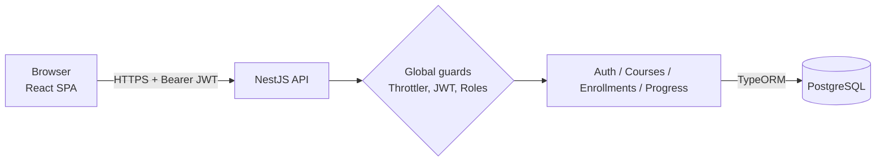

# LMS: Learning Management System

A full-stack learning platform where instructors publish courses made of text, video and PDF modules, and students enroll and track their progress. Built with React, NestJS and PostgreSQL, with role-based access and a documented REST API.

## Features

- **Auth with three roles:** register as a *student* or an *instructor* (admins are created by the seed or promoted by another admin); JWT-protected API; bcrypt password hashing; login/register rate limiting.
- **Instructors:** create, edit, publish/unpublish and delete their own courses; add, edit and delete text, video (YouTube embed) and PDF-link modules. Ownership is enforced on every write.
- **Students:** browse the published catalog, enroll, open lessons, mark modules complete, and see per-course progress on a dashboard.
- **Instructor analytics:** per course, enrolled students, average progress and unanswered questions.
- **Admin:** a dashboard with platform stats, a searchable and paginated user list (change roles, delete users) and course moderation (unpublish, delete). Admins cannot change or delete themselves.
- **Course Q&A:** enrolled students ask questions on a course; only that course's instructor can answer. Non-members get a 403.
- **Access rules:** drafts are visible only to their owner; lesson content stays hidden until the student enrolls.
- **Dark mode**, form validation (zod + React Hook Form), password visibility toggle.
- **API docs:** Swagger UI at `/docs`.

## Tech stack

| Layer | Tech |
|---|---|
| Frontend | React 18, TypeScript, Vite, Redux Toolkit, React Router, Tailwind CSS, React Hook Form + zod, Axios |
| Backend | NestJS 11, TypeORM, Passport JWT, class-validator, Swagger, Helmet, Throttler |
| Database | PostgreSQL 16 (migrations + seed script) |
| Tooling | Jest (unit + e2e with supertest), ESLint, Prettier, Docker Compose, GitHub Actions |

## Architecture



## Data model

```mermaid
erDiagram
  USER ||--o{ COURSE : "teaches (instructor)"
  COURSE ||--o{ MODULE : contains
  USER ||--o{ ENROLLMENT : "enrolls (student)"
  COURSE ||--o{ ENROLLMENT : has
  ENROLLMENT ||--o{ PROGRESS : tracks
  COURSE ||--o{ QUESTION : "Q&A"
  USER ||--o{ QUESTION : asks
  MODULE ||--o{ PROGRESS : "progress on"
  USER { uuid id PK; string email UK; string password; enum role "student, instructor, admin" }
  COURSE { uuid id PK; string title; text description; bool isPublished }
  MODULE { uuid id PK; string title; enum type; int order }
  ENROLLMENT { uuid id PK; uuid studentId; uuid courseId }
  QUESTION { uuid id PK; text body; text answer; timestamp answeredAt }
  PROGRESS { uuid id PK; bool isCompleted; float completionPercentage }
```

`ENROLLMENT (studentId, courseId)` and `PROGRESS (enrollmentId, moduleId)` are unique pairs.

## Quick start

### Option 1: Docker (one command)

```bash
docker compose up --build
```

Web: <http://localhost:5173> · API: <http://localhost:3000> · Swagger: <http://localhost:3000/docs>

The API runs migrations and seeds demo data on first boot.

### Option 2: Local development

Requires Node 22+ and a PostgreSQL database.

```bash
# API
cd backend
cp .env.example .env        # set JWT_SECRET and DB_* (or DATABASE_URL)
npm ci
npm run migration:run       # create tables
npm run seed                # demo users and courses
npm run start:dev           # http://localhost:3000

# Web (second terminal)
cd frontend
cp .env.example .env        # VITE_API_URL=http://localhost:3000
npm ci
npm run dev                 # http://localhost:5173
```

## Demo credentials

Created by the seed script (password for both: `Password123!`):

| Role | Email |
|---|---|
| Instructor | `instructor@lms.dev` |
| Admin | `admin@lms.dev` |
| Student | `student@lms.dev` |

Anyone can also register as a student or an instructor. Choosing the instructor role at sign-up is a demo shortcut; a production system would not allow it. The admin role cannot be chosen at registration.

## Testing

```bash
cd backend
npm run lint && npm run typecheck
npm test                    # unit tests (auth, progress services)
npm run test:e2e            # API flows against a real Postgres (TEST_DB_* env vars, default lms_test on localhost:5432)
cd ../frontend && npm run lint && npm run build
```

The e2e suite covers registration/login, role checks, ownership (IDOR) checks, draft visibility, enrollment, content gating, progress tracking, Q&A permissions, instructor analytics, and admin moderation. CI runs all of the above on every push.

## Deployment (free tier)

- **Database:** Neon (free Postgres). Use its connection string as `DATABASE_URL`.
- **API:** Render web service, root `backend`, build `npm ci && npm run build`, start `node dist/seed.js && node dist/main`. Env: `DATABASE_URL`, `JWT_SECRET`, `FRONTEND_URL` (your Vercel URL), `NODE_ENV=production`. Health check path: `/health`. The free tier sleeps when idle, so the first request can take about a minute.
- **Web:** Vercel, root `frontend`, framework Vite, env `VITE_API_URL` set to the Render URL.

## What I'd do next

- Quizzes; notifications when a question is answered; threaded replies on Q&A.
- Refresh tokens with httpOnly cookies instead of a token in localStorage.
- File uploads for PDFs and thumbnails; server-side pagination for the public catalog (search and paging are currently done in the browser).
- Component tests and Playwright end-to-end tests for the UI.
