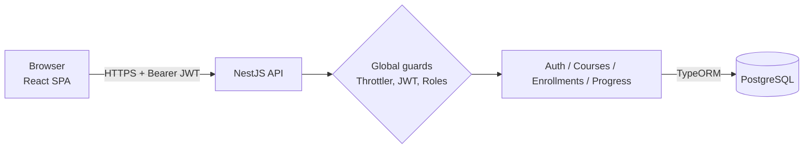
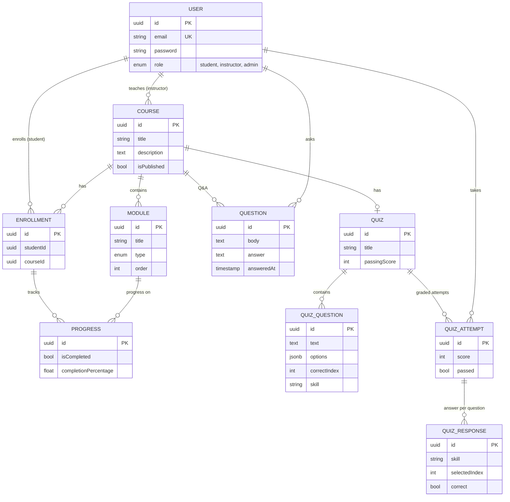

# Traceback LMS

*Find where it went wrong.*

A learning platform for computer science. Instructors build skill-tagged courses and quizzes; students see where they are strong and where they need practice, and instructors see where a whole class is struggling. Built with React, NestJS and PostgreSQL, with role-based access, a documented REST API and a mastery-tracking pipeline (the model is not yet trained on real data, so mastery is shown as a labeled estimate).

The name is the Python/JavaScript term for the report of where a program failed. Here it means the same thing for a learner: trace a wrong answer back to the skill behind it.

## Features

- **Auth with three roles:** register as a *student* or an *instructor* (admins are created by the seed or promoted by another admin); JWT-protected API; bcrypt password hashing; login/register rate limiting.
- **Instructors:** create, edit, publish/unpublish and delete their own courses; add, edit and delete text, video (YouTube embed) and PDF-link modules. Ownership is enforced on every write.
- **Students:** browse the published catalog, enroll, open lessons, mark modules complete, and see per-course progress on a dashboard.
- **Instructor analytics:** per course, enrolled students, average progress and unanswered questions.
- **Admin:** a dashboard with platform stats, a searchable and paginated user list (change roles, delete users) and course moderation (unpublish, delete). Admins cannot change or delete themselves.
- **Quizzes:** instructors build one multiple-choice quiz per course (passing score, 2-6 options per question); enrolled students take it, get an instant score and per-question feedback, and keep an attempt history. The answer key never reaches students. Each question has a skill tag, and every answer is logged per question (the data behind the planned mastery tracking). Editing a quiz keeps existing question ids, so a student's answer history survives edits.
- **Mastery tracking:** students see predicted mastery per skill (weakest first, with early-estimate warnings); instructors see their class's weakest skills per course. Until a model trained on real data is shipped, the numbers are smoothed-accuracy **estimates** and are labeled that way. See [ml/README.md](ml/README.md) for the model, evaluation method and current status.
- **Course Q&A:** enrolled students ask questions on a course; only that course's instructor can answer. Non-members get a 403.
- **Access rules:** drafts are visible only to their owner and admins; lesson content stays hidden until the student enrolls (students keep access if a course is later unpublished).
- **Hardening:** password hashes never leave the API, module links must be http(s) (blocks `javascript:` URLs), validated UUID params, rate limiting that works behind a proxy, Helmet, atomic enrollment with proper 409s on double-clicks, and a required 32+ character `JWT_SECRET` in production.
- **Dark mode**, form validation (zod + React Hook Form), password visibility toggle.
- **API docs:** Swagger UI at `/docs`; `/health` also checks the database.

## Tech stack

| Layer | Tech |
|---|---|
| Frontend | React 18, TypeScript, Vite, Redux Toolkit, React Router, Tailwind CSS, React Hook Form + zod, Axios |
| Backend | NestJS 11, TypeORM, Passport JWT, class-validator, Swagger, Helmet, Throttler |
| Database | PostgreSQL 16 (migrations + seed script) |
| ML | Python (pandas, scikit-learn) for training and evaluation; the exported model is evaluated in TypeScript inside the API, so there is no extra service to host |
| Tooling | Jest (unit + e2e with supertest), Vitest, pytest, ESLint, Prettier, ruff, Docker Compose, GitHub Actions |

## Architecture



## Data model



`ENROLLMENT (studentId, courseId)` and `PROGRESS (enrollmentId, moduleId)` are unique pairs.

## Quick start

Requires Node 22+ and a PostgreSQL database (a free [Neon](https://neon.tech) project works, no local install needed).

```bash
# API
cd backend
cp .env.example .env        # set JWT_SECRET and either DATABASE_URL (Neon) or DB_* (local Postgres)
npm ci
npm run migration:run       # create tables
npm run seed                # demo users and courses
npm run start:dev           # http://localhost:3000  (Swagger UI: /docs)

# Web (second terminal)
cd frontend
cp .env.example .env        # VITE_API_URL=http://localhost:3000
npm ci
npm run dev                 # http://localhost:5173
```

### Optional: Docker

If you have Docker, one command starts Postgres, the API and the web app (migrations and the demo seed run on first boot):

```bash
docker compose up --build
```

Web: <http://localhost:5173> · API: <http://localhost:3000> · Swagger: <http://localhost:3000/docs>

No local Docker? Open the repo in a GitHub Codespace (green **Code** button, then **Codespaces**), which has Docker preinstalled, and run the same command in its terminal.

## Design

The interface uses three colours, each with one job, defined once as design tokens in `frontend/src/index.css`:

| Role | Light | Dark | Used for |
|---|---|---|---|
| Forest green (structure) | `#1F4D3A` | mint `#8CCBA9` | Navigation bar, links, outline buttons, progress fill |
| Cream (page) | `#F7F1E3` | deep green-black `#0F1A15` | Page background; cards sit on it with a hairline border instead of heavy shadows |
| Coral (action) | `#F26B5B` | `#F47E70` | The main button on a screen and the current-page marker. Always carries dark text, never used as text colour |

Success, warning and error use their own colours and are always paired with words, not colour alone. Typography is Figtree for text and Bricolage Grotesque for headings, bundled with the app (no third-party font requests). There are no gradients, glass effects or emoji icons.

Every text and background pair is checked against WCAG AA (4.5:1) in both themes by an automated test, so changing a token cannot silently break readability.

## Demo credentials

Created by the seed script (password for both: `Password123!`):

| Role | Email |
|---|---|
| Instructor | `instructor@lms.dev` |
| Student | `student@lms.dev` |
| Admin | `admin@lms.dev` (created locally; in production only when `SEED_ADMIN_PASSWORD` is set) |

Anyone can also register as a student or an instructor. Choosing the instructor role at sign-up is a demo shortcut; a production system would not allow it. The admin role cannot be chosen at registration.

## Testing

```bash
cd backend
npm run lint && npm run typecheck
npm test                    # unit tests (auth, progress, env validation)
npm run test:e2e            # API flows against a real Postgres (TEST_DB_* env vars, default lms_test on localhost:5432)
cd ../frontend && npm run lint && npm test && npm run build   # UI tests: Vitest + Testing Library
cd ../ml && ruff check . && pytest                            # feature and pipeline tests
```

The e2e suite covers registration/login, role checks, ownership (IDOR) checks, draft visibility, enrollment, content gating, progress tracking, quizzes (grading, answer-key secrecy), Q&A permissions, instructor analytics, admin moderation, and concurrency edge cases (double enroll, double sign-up). CI runs all of the above on every push.

## Deployment (free tier)

- **Database:** Neon (free Postgres). Use its connection string as `DATABASE_URL`.
- **API:** Render web service, root `backend`, build `npm ci && npm run build`, start `node dist/seed.js && node dist/main`. Env: `DATABASE_URL`, `JWT_SECRET` (32+ characters), `FRONTEND_URL` (your Vercel URL), `NODE_ENV=production`, and optionally `SEED_ADMIN_PASSWORD` to create `admin@lms.dev` (skipped otherwise, so a public site never ships a well-known admin password). Health check path: `/health`. The free tier sleeps when idle, so the first request can take about a minute.
- **Web:** Vercel, root `frontend`, framework Vite, env `VITE_API_URL` set to the Render URL.

## Roadmap: AI/ML features

Planned in this order, one branch per step, each merged and deployable on its own. Status is stated plainly; nothing below is claimed as working unless it says so.

| Step | What | Status |
|---|---|---|
| 1. Foundations | Log every quiz answer per question with a skill tag, so there is real data to learn from | Done |
| 2. Knowledge tracing | Predict the chance a student answers the next question correctly; show per-skill mastery to students and the class's weakest skills to instructors. Pipeline, API and UI are built and tested; the model has **not** been trained on real data yet, so the app shows labeled estimates. See [ml/README.md](ml/README.md) | Built, real training pending |
| 3. UI refresh | A calmer, more distinctive visual identity: a defined colour palette as design tokens, readable typography, no template-style gradients or glass effects, accessible contrast in light and dark mode. See [Design](#design) | Built, awaiting review |
| 4. Course study assistant | An "ask this course" assistant that answers only from the course's own lessons and cites them. Includes a retrieval evaluation comparing embedding models and chunk sizes (Recall@k, MRR) on a hand-written question set | Planned |

Evaluated and deliberately left out for now: at-risk student prediction, similar-question suggestions in Q&A, a summary faithfulness checker, next-lesson recommendations and an LLM quiz generator. A standalone prompt-injection detector was dropped because it is already covered by a separate research project.

## What I'd do next

- Refresh tokens in httpOnly cookies instead of a token in localStorage (needs `SameSite=None` cookies and CSRF handling because the web app and API live on different domains).
- File uploads for PDFs and thumbnails (needs external object storage; free hosts have ephemeral disks).
- Notifications when a question is answered, and threaded Q&A replies.
- Server-side pagination for the public catalog (search and paging currently run in the browser, which is fine at this size).
- Playwright end-to-end tests for the full browser flows.

## License

MIT, see [LICENSE](LICENSE). Copyright (c) 2026 Nischal Dhoj Kunwar ([@nischalk17](https://github.com/nischalk17)).
